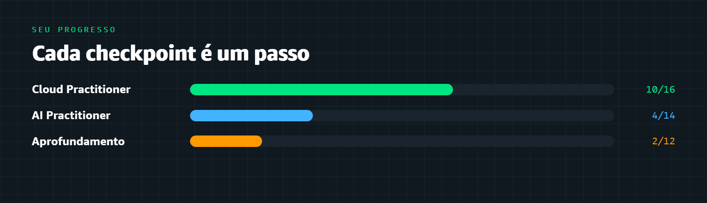

# 📊 Progresso da turma

Atualizado automaticamente a cada checkpoint registrado · 2026-11-14

---

## 🏆 Ranking

| # | Aluno(a) | Módulos concluídos | Medalhas | Perfil |
|:--:|:--|:--:|:--|:--:|
| 1 | [@pereira-devcarlos](https://github.com/pereira-devcarlos) | 17 | ☁️ 🔐 🧰 💰 🏆 | [🌐](https://awsbuildersunifal.vercel.app/u/pereira-devcarlos) |
| 2 | [@PedroFerreira5](https://github.com/PedroFerreira5) | 17 | ☁️ 🔐 🧰 💰 🏆 | [🌐](https://awsbuildersunifal.vercel.app/u/PedroFerreira5) |
| 3 | [@douglasgiraldello](https://github.com/douglasgiraldello) | 17 | ☁️ 🔐 🧰 💰 🏆 | [🌐](https://awsbuildersunifal.vercel.app/u/douglasgiraldello) |
| 4 | [@gco-code](https://github.com/gco-code) | 17 | ☁️ 🔐 🧰 💰 🏆 | [🌐](https://awsbuildersunifal.vercel.app/u/gco-code) |
| 5 | [@frantonissi](https://github.com/frantonissi) | 17 | ☁️ 🔐 🧰 💰 🏆 | [🌐](https://awsbuildersunifal.vercel.app/u/frantonissi) |
| 6 | [@J3ff23](https://github.com/J3ff23) | 17 | ☁️ 🔐 🧰 💰 🏆 | [🌐](https://awsbuildersunifal.vercel.app/u/J3ff23) |
| 7 | [@Gabriela-Mazon](https://github.com/Gabriela-Mazon) | 14 | ☁️ 🔐 🧰 | [🌐](https://awsbuildersunifal.vercel.app/u/Gabriela-Mazon) |
| 8 | [@CrispimCesarJulio](https://github.com/CrispimCesarJulio) | 14 | ☁️ 🔐 🧰 | [🌐](https://awsbuildersunifal.vercel.app/u/CrispimCesarJulio) |
| 9 | [@Thyago-bat](https://github.com/Thyago-bat) | 9 | ☁️ 🔐 | [🌐](https://awsbuildersunifal.vercel.app/u/Thyago-bat) |
| 10 | [@MarcosBento06](https://github.com/MarcosBento06) | 8 | ☁️ 🔐 | [🌐](https://awsbuildersunifal.vercel.app/u/MarcosBento06) |
| 11 | [@Otavio-oliv](https://github.com/Otavio-oliv) | 6 | — | [🌐](https://awsbuildersunifal.vercel.app/u/Otavio-oliv) |
| 12 | [@guilhermereisdev](https://github.com/guilhermereisdev) | 4 | ☁️ | [🌐](https://awsbuildersunifal.vercel.app/u/guilhermereisdev) |
| 13 | [@JA-Lassister](https://github.com/JA-Lassister) | 4 | ☁️ | [🌐](https://awsbuildersunifal.vercel.app/u/JA-Lassister) |
| 14 | [@Petronio-Jr](https://github.com/Petronio-Jr) | 4 | ☁️ | [🌐](https://awsbuildersunifal.vercel.app/u/Petronio-Jr) |
| 15 | [@Otavio-A-Miguel](https://github.com/Otavio-A-Miguel) | 4 | ☁️ | [🌐](https://awsbuildersunifal.vercel.app/u/Otavio-A-Miguel) |
| 16 | [@hugosoaresdev](https://github.com/hugosoaresdev) | 4 | ☁️ | [🌐](https://awsbuildersunifal.vercel.app/u/hugosoaresdev) |
| 17 | [@Diego-Montemor](https://github.com/Diego-Montemor) | 4 | — | [🌐](https://awsbuildersunifal.vercel.app/u/Diego-Montemor) |
| 18 | [@Vic-Tambasco](https://github.com/Vic-Tambasco) | 4 | ☁️ | [🌐](https://awsbuildersunifal.vercel.app/u/Vic-Tambasco) |
| 19 | [@Amoreirinha](https://github.com/Amoreirinha) | 4 | — | [🌐](https://awsbuildersunifal.vercel.app/u/Amoreirinha) |
| 20 | [@Luis-Unifal](https://github.com/Luis-Unifal) | 3 | — | [🌐](https://awsbuildersunifal.vercel.app/u/Luis-Unifal) |
| 21 | [@daviazarias](https://github.com/daviazarias) | 2 | — | [🌐](https://awsbuildersunifal.vercel.app/u/daviazarias) |
| 22 | [@darlansm47-stack](https://github.com/darlansm47-stack) | 1 | — | [🌐](https://awsbuildersunifal.vercel.app/u/darlansm47-stack) |

> [!TIP]
> **Como ganhar medalhas:** conclua todos os módulos de um domínio. Use o número no checkpoint (ex.: `Domínio 1 · Módulo 03`) para o robô reconhecer.
>
> **Perfil público:** cada pessoa do ranking tem uma página em `awsbuildersunifal.vercel.app/u/seu-usuario` — com trilhas, medalhas, eventos e certificados.

---

## 📈 Detalhe por pessoa

### [@pereira-devcarlos](https://github.com/pereira-devcarlos)

| Trilha | Progresso | Módulos | % |
|:--|:--|:--:|:--:|
| Certificação Cloud Practitioner | `████████████████████████` | 17/17 | 100% |
| Certificação AI Practitioner | `░░░░░░░░░░░░░░░░░░░░░░░░` | 0/14 | 0% |
| Aprendizado Aprofundado | `░░░░░░░░░░░░░░░░░░░░░░░░` | 0/12 | 0% |

**Medalhas:**

- ☁️ **Conceitos de Nuvem** · Certificação Cloud Practitioner
- 🔐 **Segurança** · Certificação Cloud Practitioner
- 🧰 **Tecnologia e Serviços** · Certificação Cloud Practitioner
- 💰 **Cobrança e Suporte** · Certificação Cloud Practitioner
- 🏆 **Trilha completa** · Certificação Cloud Practitioner

🌐 [Perfil público](https://awsbuildersunifal.vercel.app/u/pereira-devcarlos)

### [@PedroFerreira5](https://github.com/PedroFerreira5)

| Trilha | Progresso | Módulos | % |
|:--|:--|:--:|:--:|
| Certificação Cloud Practitioner | `████████████████████████` | 17/17 | 100% |
| Certificação AI Practitioner | `░░░░░░░░░░░░░░░░░░░░░░░░` | 0/14 | 0% |
| Aprendizado Aprofundado | `░░░░░░░░░░░░░░░░░░░░░░░░` | 0/12 | 0% |

**Medalhas:**

- ☁️ **Conceitos de Nuvem** · Certificação Cloud Practitioner
- 🔐 **Segurança** · Certificação Cloud Practitioner
- 🧰 **Tecnologia e Serviços** · Certificação Cloud Practitioner
- 💰 **Cobrança e Suporte** · Certificação Cloud Practitioner
- 🏆 **Trilha completa** · Certificação Cloud Practitioner

🌐 [Perfil público](https://awsbuildersunifal.vercel.app/u/PedroFerreira5)

### [@douglasgiraldello](https://github.com/douglasgiraldello)

| Trilha | Progresso | Módulos | % |
|:--|:--|:--:|:--:|
| Certificação Cloud Practitioner | `████████████████████████` | 17/17 | 100% |
| Certificação AI Practitioner | `░░░░░░░░░░░░░░░░░░░░░░░░` | 0/14 | 0% |
| Aprendizado Aprofundado | `░░░░░░░░░░░░░░░░░░░░░░░░` | 0/12 | 0% |

**Medalhas:**

- ☁️ **Conceitos de Nuvem** · Certificação Cloud Practitioner
- 🔐 **Segurança** · Certificação Cloud Practitioner
- 🧰 **Tecnologia e Serviços** · Certificação Cloud Practitioner
- 💰 **Cobrança e Suporte** · Certificação Cloud Practitioner
- 🏆 **Trilha completa** · Certificação Cloud Practitioner

🌐 [Perfil público](https://awsbuildersunifal.vercel.app/u/douglasgiraldello)

### [@gco-code](https://github.com/gco-code)

| Trilha | Progresso | Módulos | % |
|:--|:--|:--:|:--:|
| Certificação Cloud Practitioner | `████████████████████████` | 17/17 | 100% |
| Certificação AI Practitioner | `░░░░░░░░░░░░░░░░░░░░░░░░` | 0/14 | 0% |
| Aprendizado Aprofundado | `░░░░░░░░░░░░░░░░░░░░░░░░` | 0/12 | 0% |

**Medalhas:**

- ☁️ **Conceitos de Nuvem** · Certificação Cloud Practitioner
- 🔐 **Segurança** · Certificação Cloud Practitioner
- 🧰 **Tecnologia e Serviços** · Certificação Cloud Practitioner
- 💰 **Cobrança e Suporte** · Certificação Cloud Practitioner
- 🏆 **Trilha completa** · Certificação Cloud Practitioner

🌐 [Perfil público](https://awsbuildersunifal.vercel.app/u/gco-code)

### [@frantonissi](https://github.com/frantonissi)

| Trilha | Progresso | Módulos | % |
|:--|:--|:--:|:--:|
| Certificação Cloud Practitioner | `████████████████████████` | 17/17 | 100% |
| Certificação AI Practitioner | `░░░░░░░░░░░░░░░░░░░░░░░░` | 0/14 | 0% |
| Aprendizado Aprofundado | `░░░░░░░░░░░░░░░░░░░░░░░░` | 0/12 | 0% |

**Medalhas:**

- ☁️ **Conceitos de Nuvem** · Certificação Cloud Practitioner
- 🔐 **Segurança** · Certificação Cloud Practitioner
- 🧰 **Tecnologia e Serviços** · Certificação Cloud Practitioner
- 💰 **Cobrança e Suporte** · Certificação Cloud Practitioner
- 🏆 **Trilha completa** · Certificação Cloud Practitioner

🌐 [Perfil público](https://awsbuildersunifal.vercel.app/u/frantonissi)

### [@J3ff23](https://github.com/J3ff23)

| Trilha | Progresso | Módulos | % |
|:--|:--|:--:|:--:|
| Certificação Cloud Practitioner | `████████████████████████` | 17/17 | 100% |
| Certificação AI Practitioner | `░░░░░░░░░░░░░░░░░░░░░░░░` | 0/14 | 0% |
| Aprendizado Aprofundado | `░░░░░░░░░░░░░░░░░░░░░░░░` | 0/12 | 0% |

**Medalhas:**

- ☁️ **Conceitos de Nuvem** · Certificação Cloud Practitioner
- 🔐 **Segurança** · Certificação Cloud Practitioner
- 🧰 **Tecnologia e Serviços** · Certificação Cloud Practitioner
- 💰 **Cobrança e Suporte** · Certificação Cloud Practitioner
- 🏆 **Trilha completa** · Certificação Cloud Practitioner

🌐 [Perfil público](https://awsbuildersunifal.vercel.app/u/J3ff23)

### [@Gabriela-Mazon](https://github.com/Gabriela-Mazon)

| Trilha | Progresso | Módulos | % |
|:--|:--|:--:|:--:|
| Certificação Cloud Practitioner | `████████████████████░░░░` | 14/17 | 82% |
| Certificação AI Practitioner | `░░░░░░░░░░░░░░░░░░░░░░░░` | 0/14 | 0% |
| Aprendizado Aprofundado | `░░░░░░░░░░░░░░░░░░░░░░░░` | 0/12 | 0% |

**Medalhas:**

- ☁️ **Conceitos de Nuvem** · Certificação Cloud Practitioner
- 🔐 **Segurança** · Certificação Cloud Practitioner
- 🧰 **Tecnologia e Serviços** · Certificação Cloud Practitioner

🌐 [Perfil público](https://awsbuildersunifal.vercel.app/u/Gabriela-Mazon)

### [@CrispimCesarJulio](https://github.com/CrispimCesarJulio)

| Trilha | Progresso | Módulos | % |
|:--|:--|:--:|:--:|
| Certificação Cloud Practitioner | `████████████████████░░░░` | 14/17 | 82% |
| Certificação AI Practitioner | `░░░░░░░░░░░░░░░░░░░░░░░░` | 0/14 | 0% |
| Aprendizado Aprofundado | `░░░░░░░░░░░░░░░░░░░░░░░░` | 0/12 | 0% |

**Medalhas:**

- ☁️ **Conceitos de Nuvem** · Certificação Cloud Practitioner
- 🔐 **Segurança** · Certificação Cloud Practitioner
- 🧰 **Tecnologia e Serviços** · Certificação Cloud Practitioner

🌐 [Perfil público](https://awsbuildersunifal.vercel.app/u/CrispimCesarJulio)

### [@Thyago-bat](https://github.com/Thyago-bat)

| Trilha | Progresso | Módulos | % |
|:--|:--|:--:|:--:|
| Certificação Cloud Practitioner | `█████████████░░░░░░░░░░░` | 9/17 | 53% |
| Certificação AI Practitioner | `░░░░░░░░░░░░░░░░░░░░░░░░` | 0/14 | 0% |
| Aprendizado Aprofundado | `░░░░░░░░░░░░░░░░░░░░░░░░` | 0/12 | 0% |

**Medalhas:**

- ☁️ **Conceitos de Nuvem** · Certificação Cloud Practitioner
- 🔐 **Segurança** · Certificação Cloud Practitioner

🌐 [Perfil público](https://awsbuildersunifal.vercel.app/u/Thyago-bat)

### [@MarcosBento06](https://github.com/MarcosBento06)

| Trilha | Progresso | Módulos | % |
|:--|:--|:--:|:--:|
| Certificação Cloud Practitioner | `███████████░░░░░░░░░░░░░` | 8/17 | 47% |
| Certificação AI Practitioner | `░░░░░░░░░░░░░░░░░░░░░░░░` | 0/14 | 0% |
| Aprendizado Aprofundado | `░░░░░░░░░░░░░░░░░░░░░░░░` | 0/12 | 0% |

**Medalhas:**

- ☁️ **Conceitos de Nuvem** · Certificação Cloud Practitioner
- 🔐 **Segurança** · Certificação Cloud Practitioner

🌐 [Perfil público](https://awsbuildersunifal.vercel.app/u/MarcosBento06)

### [@Otavio-oliv](https://github.com/Otavio-oliv)

| Trilha | Progresso | Módulos | % |
|:--|:--|:--:|:--:|
| Certificação Cloud Practitioner | `████████░░░░░░░░░░░░░░░░` | 6/17 | 35% |
| Certificação AI Practitioner | `░░░░░░░░░░░░░░░░░░░░░░░░` | 0/14 | 0% |
| Aprendizado Aprofundado | `░░░░░░░░░░░░░░░░░░░░░░░░` | 0/12 | 0% |

**Medalhas:**

_Nenhuma medalha ainda — conclua todos os módulos de um domínio para ganhar a primeira!_

🌐 [Perfil público](https://awsbuildersunifal.vercel.app/u/Otavio-oliv)

### [@guilhermereisdev](https://github.com/guilhermereisdev)

| Trilha | Progresso | Módulos | % |
|:--|:--|:--:|:--:|
| Certificação Cloud Practitioner | `██████░░░░░░░░░░░░░░░░░░` | 4/17 | 24% |
| Certificação AI Practitioner | `░░░░░░░░░░░░░░░░░░░░░░░░` | 0/14 | 0% |
| Aprendizado Aprofundado | `░░░░░░░░░░░░░░░░░░░░░░░░` | 0/12 | 0% |

**Medalhas:**

- ☁️ **Conceitos de Nuvem** · Certificação Cloud Practitioner

🌐 [Perfil público](https://awsbuildersunifal.vercel.app/u/guilhermereisdev)

### [@JA-Lassister](https://github.com/JA-Lassister)

| Trilha | Progresso | Módulos | % |
|:--|:--|:--:|:--:|
| Certificação Cloud Practitioner | `██████░░░░░░░░░░░░░░░░░░` | 4/17 | 24% |
| Certificação AI Practitioner | `░░░░░░░░░░░░░░░░░░░░░░░░` | 0/14 | 0% |
| Aprendizado Aprofundado | `░░░░░░░░░░░░░░░░░░░░░░░░` | 0/12 | 0% |

**Medalhas:**

- ☁️ **Conceitos de Nuvem** · Certificação Cloud Practitioner

🌐 [Perfil público](https://awsbuildersunifal.vercel.app/u/JA-Lassister)

### [@Petronio-Jr](https://github.com/Petronio-Jr)

| Trilha | Progresso | Módulos | % |
|:--|:--|:--:|:--:|
| Certificação Cloud Practitioner | `██████░░░░░░░░░░░░░░░░░░` | 4/17 | 24% |
| Certificação AI Practitioner | `░░░░░░░░░░░░░░░░░░░░░░░░` | 0/14 | 0% |
| Aprendizado Aprofundado | `░░░░░░░░░░░░░░░░░░░░░░░░` | 0/12 | 0% |

**Medalhas:**

- ☁️ **Conceitos de Nuvem** · Certificação Cloud Practitioner

🌐 [Perfil público](https://awsbuildersunifal.vercel.app/u/Petronio-Jr)

### [@Otavio-A-Miguel](https://github.com/Otavio-A-Miguel)

| Trilha | Progresso | Módulos | % |
|:--|:--|:--:|:--:|
| Certificação Cloud Practitioner | `██████░░░░░░░░░░░░░░░░░░` | 4/17 | 24% |
| Certificação AI Practitioner | `░░░░░░░░░░░░░░░░░░░░░░░░` | 0/14 | 0% |
| Aprendizado Aprofundado | `░░░░░░░░░░░░░░░░░░░░░░░░` | 0/12 | 0% |

**Medalhas:**

- ☁️ **Conceitos de Nuvem** · Certificação Cloud Practitioner

🌐 [Perfil público](https://awsbuildersunifal.vercel.app/u/Otavio-A-Miguel)

### [@hugosoaresdev](https://github.com/hugosoaresdev)

| Trilha | Progresso | Módulos | % |
|:--|:--|:--:|:--:|
| Certificação Cloud Practitioner | `██████░░░░░░░░░░░░░░░░░░` | 4/17 | 24% |
| Certificação AI Practitioner | `░░░░░░░░░░░░░░░░░░░░░░░░` | 0/14 | 0% |
| Aprendizado Aprofundado | `░░░░░░░░░░░░░░░░░░░░░░░░` | 0/12 | 0% |

**Medalhas:**

- ☁️ **Conceitos de Nuvem** · Certificação Cloud Practitioner

🌐 [Perfil público](https://awsbuildersunifal.vercel.app/u/hugosoaresdev)

### [@Diego-Montemor](https://github.com/Diego-Montemor)

| Trilha | Progresso | Módulos | % |
|:--|:--|:--:|:--:|
| Certificação Cloud Practitioner | `██████░░░░░░░░░░░░░░░░░░` | 4/17 | 24% |
| Certificação AI Practitioner | `░░░░░░░░░░░░░░░░░░░░░░░░` | 0/14 | 0% |
| Aprendizado Aprofundado | `░░░░░░░░░░░░░░░░░░░░░░░░` | 0/12 | 0% |

**Medalhas:**

_Nenhuma medalha ainda — conclua todos os módulos de um domínio para ganhar a primeira!_

🌐 [Perfil público](https://awsbuildersunifal.vercel.app/u/Diego-Montemor)

### [@Vic-Tambasco](https://github.com/Vic-Tambasco)

| Trilha | Progresso | Módulos | % |
|:--|:--|:--:|:--:|
| Certificação Cloud Practitioner | `██████░░░░░░░░░░░░░░░░░░` | 4/17 | 24% |
| Certificação AI Practitioner | `░░░░░░░░░░░░░░░░░░░░░░░░` | 0/14 | 0% |
| Aprendizado Aprofundado | `░░░░░░░░░░░░░░░░░░░░░░░░` | 0/12 | 0% |

**Medalhas:**

- ☁️ **Conceitos de Nuvem** · Certificação Cloud Practitioner

🌐 [Perfil público](https://awsbuildersunifal.vercel.app/u/Vic-Tambasco)

### [@Amoreirinha](https://github.com/Amoreirinha)

| Trilha | Progresso | Módulos | % |
|:--|:--|:--:|:--:|
| Certificação Cloud Practitioner | `██████░░░░░░░░░░░░░░░░░░` | 4/17 | 24% |
| Certificação AI Practitioner | `░░░░░░░░░░░░░░░░░░░░░░░░` | 0/14 | 0% |
| Aprendizado Aprofundado | `░░░░░░░░░░░░░░░░░░░░░░░░` | 0/12 | 0% |

**Medalhas:**

_Nenhuma medalha ainda — conclua todos os módulos de um domínio para ganhar a primeira!_

🌐 [Perfil público](https://awsbuildersunifal.vercel.app/u/Amoreirinha)

### [@Luis-Unifal](https://github.com/Luis-Unifal)

| Trilha | Progresso | Módulos | % |
|:--|:--|:--:|:--:|
| Certificação Cloud Practitioner | `████░░░░░░░░░░░░░░░░░░░░` | 3/17 | 18% |
| Certificação AI Practitioner | `░░░░░░░░░░░░░░░░░░░░░░░░` | 0/14 | 0% |
| Aprendizado Aprofundado | `░░░░░░░░░░░░░░░░░░░░░░░░` | 0/12 | 0% |

**Medalhas:**

_Nenhuma medalha ainda — conclua todos os módulos de um domínio para ganhar a primeira!_

🌐 [Perfil público](https://awsbuildersunifal.vercel.app/u/Luis-Unifal)

### [@daviazarias](https://github.com/daviazarias)

| Trilha | Progresso | Módulos | % |
|:--|:--|:--:|:--:|
| Certificação Cloud Practitioner | `███░░░░░░░░░░░░░░░░░░░░░` | 2/17 | 12% |
| Certificação AI Practitioner | `░░░░░░░░░░░░░░░░░░░░░░░░` | 0/14 | 0% |
| Aprendizado Aprofundado | `░░░░░░░░░░░░░░░░░░░░░░░░` | 0/12 | 0% |

**Medalhas:**

_Nenhuma medalha ainda — conclua todos os módulos de um domínio para ganhar a primeira!_

🌐 [Perfil público](https://awsbuildersunifal.vercel.app/u/daviazarias)

### [@darlansm47-stack](https://github.com/darlansm47-stack)

| Trilha | Progresso | Módulos | % |
|:--|:--|:--:|:--:|
| Certificação Cloud Practitioner | `░░░░░░░░░░░░░░░░░░░░░░░░` | 0/17 | 0% |
| Certificação AI Practitioner | `██░░░░░░░░░░░░░░░░░░░░░░` | 1/14 | 7% |
| Aprendizado Aprofundado | `░░░░░░░░░░░░░░░░░░░░░░░░` | 0/12 | 0% |

**Medalhas:**

_Nenhuma medalha ainda — conclua todos os módulos de um domínio para ganhar a primeira!_

🌐 [Perfil público](https://awsbuildersunifal.vercel.app/u/darlansm47-stack)

---

🏠 [Voltar ao início](./README.md)

