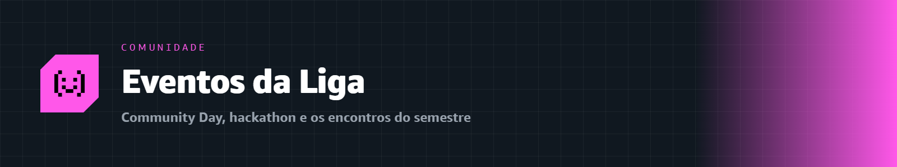

  

# 🎉 Eventos da Liga

### Registros e memórias dos nossos encontros

LACEN · Liga Acadêmica de Computação em Nuvem · UNIFAL-MG

---

Ao longo do ciclo, a Liga promove uma série de **eventos presenciais e online** para a comunidade — palestras, workshops práticos, encontros de estudo e muito mais. Além disso, celebramos dois marcos especiais: um **AWS Community Day** e um **Hackathon**. 🚀

Esta pasta é organizada **por mês** — cada mês reúne todos os encontros que aconteceram nele: o que rolou, materiais, gravações e o link das fotos.

---

## 📅 Ciclo 2026–2027

| Mês | Encontros | Destaques |
|:--|:--:|:--|
| 📅 [Agosto 2026](./2026-08-agosto/) | 1 | Fundamentos de Computação em Nuvem |
| 📅 [Setembro 2026](./2026-09-setembro/) | 4 | Durable Functions · DemoDay · Palestra com Caio Valcazara · O Arsenal AWS |
| 📅 [Outubro 2026](./2026-10-outubro/) | 2 | AWS Kiro (20–22) · Segurança na Nuvem AWS (28) |
| 📅 [Novembro 2026](./2026-11-novembro/) | — | Encerramento da trilha de certificação |
| 🌟 [Maio 2027](./2027-05-maio/) | 2 | AWS Community Day · Hackathon |

---

🏠 [Voltar ao início](../) &nbsp;·&nbsp; 💜 [Sobre a Liga](../sobre/) &nbsp;·&nbsp; 📸 [Instagram](https://www.instagram.com/awsbuilders.unifal)

